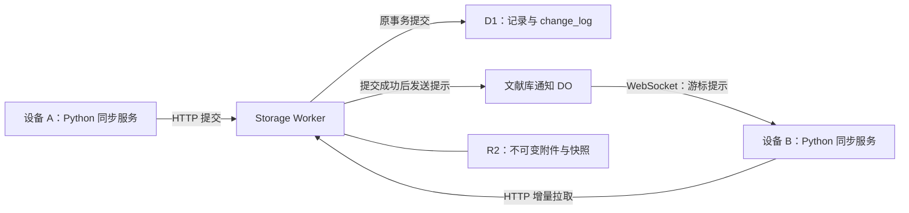

# 文献库变更通知：Durable Objects 与可休眠 WebSocket

日期：2026-10-23

状态：**已按本文实现并加入本地回归测试；尚未部署云端或实测生产计费。**

本文补充 [文献存储、离线同步与冲突处理设计](storage-offline-sync-design.md) 和 [Storage API](storage-api.md)。第 1–10 节保留讨论时的设计及验收要求；第 11 节记录实际实现与验证边界。

## 1. 已确认的决定

- Cloudflare 后端采用 **一个文献库一个 Durable Object 实例**，所有实例共用同一个 DO 类。这里的文献库是整个逻辑库，不是单篇文献；同库所有设备连接同一实例。
- DO 只负责保持设备连接和广播变更提示。云端 D1 / R2 仍是权威数据源，本地 SQLite 仍保存工作副本、待提交修改和已持久接收的游标。
- 使用 **WebSocket Hibernation API**，允许 DO 空闲休眠而连接保持。
- 通知触发现有增量同步，不另造一套消息传输、合并或离线队列协议。
- 连接正常时显著减少固定间隔的远端轮询；保留断线补齐和低频兜底检查。
- 客户端的通知能力保持通用，其他云端实现相同协议即可使用；未提供通知接口的服务继续支持轮询。

后文的接口名称、消息字段与时间参数是建议方案，主会话可结合现有约定调整；上述数据安全边界不变。

## 2. 为什么做

以撰写本文时的工作区为准，`textfold/offline_storage.py` 的后台循环每 30 秒运行一次 `sync()`。启动、保存和前端窗口恢复等事件也会请求同步。

在 v2 已启用、没有新变化和待上传修改的常见路径上，一轮仍可能访问：

1. `/v2/health`。
2. `/v2/changes`。
3. `/v2/library`，即便库级记录未改变也读取快照。
4. 再次 `/v2/changes`。

只按这一稳定路径估算，持续运行是每设备约 480 次 HTTP 请求/小时，尚未计入恢复窗口等触发。实际数量取决于当前代码路径、错误和旧协议兼容状态，不能把估算当实测。

`textfold/web/app.js` 的 10 秒状态刷新和设置页 3 秒刷新访问本地 Python 服务；不能把这些本地请求直接算成 Cloudflare 调用。需要优化的是远端同步调度及其中无变化时的读取。

目标是在空闲时只维持低成本连接，在真正发生变化时及时通知其他设备。

## 3. 架构与职责



| 部件 | 职责 |
| --- | --- |
| D1 | 继续持久化记录、删除标记、幂等操作及 change_log；不迁移到 DO |
| R2 | 继续保存原件、附件、恢复快照；二进制传输不绕道 DO |
| 通知 DO | 维护本库设备连接、广播变化提示；不判断修改胜负，不保存另一份权威游标 |
| Python 同步服务 | 每个运行中的库工作区维护一条连接，合并触发事件，执行现有同步和持久化 |
| 前端 | 查询本地状态、展示待同步/错误/冲突；不直接持有云端凭据或为每个标签页建立远端连接 |

多个独立客户端进程各有连接是正常情况；需要避免同一后台因打开多个页面或多次 `start()` 而重复建立连接。

### DO 实例定位

使用云端持久 `library_id` 确定实例名，例如 `library-notifications:<library_id>`。复用现有库身份，不按文献 ID、设备 ID、连接次数或随机值创建实例。

服务端应从认证后的服务上下文解析库身份。客户端传来的库 ID 只能用来校验，不能成为跨库访问的授权依据。当前若一套服务只承载一个库，就连接该服务已有的库。

免费套餐限制的 class 数量与实例数量不同：当前官方文档说明 SQLite-backed DO 实例数量不限，免费套餐 class 上限为 100。因此这个方案只需增加一个 class，不需要每库增加一个 class。[官方限制](https://developers.cloudflare.com/durable-objects/platform/limits/)

## 4. 通用通知协议建议

通知是 Storage API v2 的可选能力，不改变现有文献接口。

### 能力发现与认证

建议在已有 `/v2/health` 响应增加可选字段，旧客户端忽略它，旧服务不返回它：

```json
{
  "notifications": {
    "protocol": "textfold/changes-ws-v1",
    "path": "/v2/events"
  }
}
```

- 路径必须基于已配置的服务入口解析，并保持同源；考虑服务部署在子路径下的情况，具体路径语义需在 API 文档中定义。
- HTTPS 服务通过 WSS 连接；只对显式本地开发入口允许明文连接。
- Python 使用现有 keyring 凭据，在 WebSocket 握手的 Authorization 请求头中认证。升级请求必须经过与 HTTP API 相同的认证边界。
- 密码不能放进 URL、查询参数、WebSocket 子协议或通知内容。不能在跨源重定向中转发凭据。
- 未声明该能力时直接轮询。声明后端点不可用、协议不兼容或升级失败时可降级；认证失败需要明确提示并停止紧密重试，不能当成无通知能力永久缓存。

### 服务端消息

建议仅提供两种消息：

```json
{"type":"ready","protocol":"textfold/changes-ws-v1","library_id":"<stable-library-id>"}
{"type":"changed","library_id":"<stable-library-id>","cursor":123}
```

- `ready` 表示已完成认证并注册订阅，客户端应启动一次正常同步以补齐变化。它不证明已同步。
- `changed` 是“云端可能有新变化”的提示。首版不携带正文、笔记、标题、凭据或完整记录。
- `cursor` 沿用当前 v2 的非负整数格式；未来变更格式需要显式版本协商，不能悄悄转换。游标只在同一库内有效，不能用时间戳替代。
- 对格式错误、过大消息、错误库身份和不支持的协议进行校验。库身份不一致必须停止该连接并报告，不能自动把本地工作区重新绑定到新库。
- 当前不需要客户端通过 WebSocket 提交数据，也不需要订阅任意文献/任意库的命令。

## 5. 正确性与竞态

### 通知永远不能充当同步确认

接收到通知不能直接更新持久游标、清除待提交项、确认保存或丢弃冲突。只有现有 HTTP 同步流程在本地事务中安全处理了返回结果，才可以推进相应状态。

重复、乱序和丢失的通知均允许；数据最终一致性依赖持久 change_log、增量拉取、CAS、幂等操作和本地 outbox。

### 提交与广播

1. 原有附件上传校验、D1 事务与 CAS 检查照旧执行。
2. 只有事务确认提交后，才触发所属库 DO 的广播；失败的 CAS 不广播一次不存在的成功修改。
3. 广播任务必须被运行时管理，例如受控的 `waitUntil()`；不能使用无人等待的 Promise。
4. 广播失败不能把已经提交的修改变成客户端看到的保存失败，更不能撤回或删除已提交数据。记录经过脱敏的投递错误，交由补齐机制恢复。
5. D1 提交与 DO 调用不是原子事务。进程可能在两者之间结束，所以不能承诺通知必达。首版不为通知额外引入持久消息队列或事务 outbox。
6. 不依赖 DO 消息顺序判断 D1 提交顺序。若发送游标，来源必须是已提交的日志；读取时看到更晚的已提交游标也安全，因为提示只会触发拉取。

### 建连与同步顺序

在已有 HTTP 健康检查校验库身份后建立连接，服务端先注册订阅再发送 `ready`。客户端收到 `ready` 后必须执行一次正常同步，覆盖建立连接前及握手期间的变化。

不能仅仅“先拉一次、再连接、然后永远等待通知”，否则两步之间的提交可能漏掉。连接期间收到的消息必须与当前同步任务一起纳入调度。

### 同步过程中到达的新变化

保持单一同步执行者，WebSocket 回调只设置同步请求，不直接执行数据库合并。调度器需要可靠的请求代数/待处理标志：

- 同步开始前捕获当前请求代数；同步结束后若又收到通知或本地保存，至少再检查一轮。
- 合并同一批通知，避免每条通知并发启动完整同步。
- 检查并清除待处理状态需要避免竞态，不能在同步结束时无条件清掉刚收到的新事件。
- 自己提交产生的回声通知允许合并；不能为减少回声而忽略并发的其他设备修改。

## 6. 调度与连接生命周期

下列时间参数为建议初值，主会话可调整并使用可注入时钟验证。

| 情况 | 建议行为 |
| --- | --- |
| 启动/首次连接/重连成功 | 正常同步一次；首次索引与旧协议兼容流程照旧 |
| 本地保存 | 持久化后立即请求同步，可短暂合并连续保存；不等待远端通知 |
| 收到变化提示 | 合并触发一次增量同步；正在同步则记录下一轮需求 |
| 连接健康、无本地待提交项 | 取消原固定 30 秒完整同步；约每 5 分钟做一次带随机抖动的兜底健康检查 |
| 兜底检查游标不变、无待提交项 | 复用现有身份校验并尽早返回，不继续拉变化或库级快照 |
| 通知缺失/连接中断 | 继续 HTTP 同步；无变化时可从 30 秒逐步放缓到 5 分钟，有本地保存及时尝试 |
| 网络故障 | 对重连及失败同步统一限流，建议 1、2、4 秒递增至最多 60 秒并加抖动，避免多个定时器叠加 |
| 认证失败 | 明确显示认证问题，等待配置更新或受控重试，避免每秒撞认证接口 |
| 网络恢复/窗口恢复/手动同步 | 去抖后请求同步；网络恢复可提前唤醒退避，窗口聚焦不应反复销毁健康连接 |
| 关闭或切换库/账号/入口 | 取消连接和重试；旧连接事件不得进入新工作区；保留现有切换保护 |

兜底的 5 分钟也是漏通知时的检测延迟预算，仍需考虑系统休眠、网络故障和调度延迟。不是每 5 分钟无条件下载整库。

如果还有待提交项、结果不明的请求、首次索引未完成、需恢复的本地状态，或 v1 写入尚未被 v2 激活隔离，不能仅凭“游标相同”跳过原有恢复/兼容工作。`@library` 的无变化快照优化也要以变更日志覆盖该记录及兼容状态为前提。

### 空闲连接检测与休眠

DO 使用 `ctx.acceptWebSocket()` 及休眠事件处理器。休眠后内存对象会重建，连接信息通过平台连接枚举及必要的 attachment 恢复；不能只放在普通内存 Map 中。

不要在 DO 内设置常驻心跳 `setInterval`、重复 alarm 或维持外部连接，使它无法休眠。需要检测半断开的连接时优先使用 Python 客户端发出的 WebSocket 协议 ping；若选应用层心跳，则评估 `setWebSocketAutoResponse()`，并核对其请求计费，不能假设应用层消息全免费。心跳频率应能配置，建议从 60 秒级开始测量。

DO 休眠不等于客户端永不断线。网络切换、休眠、进程重启、凭据变化和部署都需要重连与补齐。

### 状态语义

分别记录通知连接状态、最近成功同步时间、待同步数量、最近同步错误。WebSocket 连着不能让失败的 HTTP 同步显示为成功；WebSocket 不可用但 HTTP 正常时，也不能阻止同步或错误提示为完全离线。前端可以先沿用现有本地状态刷新。

## 7. 兼容性与数据安全

- 不改变原文不可变规则、批注冲突保留、删除与编辑并发处理、对话分支和既有幂等确认流程。
- 不迁移或删除旧本地文献；新增通知能力不要求原有目录迁移，也不改已有本地 SQLite 内容来适配通知。
- 新客户端连接不支持通知的 v2 服务仍可同步；旧客户端连接启用通知的新服务仍可轮询。既有 v1/v2 写入隔离规则继续有效。
- 非 Cloudflare 服务可实现同样的能力声明和 WebSocket 协议；客户端代码不出现 DO 绑定、Cloudflare 账号或 Wrangler 配置概念。
- 凭据仍使用 keyring；DO 不需要把用户密码存入其数据库或连接 attachment。
- 配置更新、库身份变化后，使用工作区/连接代数隔离旧回调。已关闭连接不能继续唤醒被释放的缓存或提交到新的目标。
- DO 绑定缺失、配额不足或服务故障时，HTTP 存储与同步仍应可用；通知能力可关闭并降级，不能让正常提交依赖 DO 健康。

## 8. 主会话建议修改范围

以下是导航建议，不要求按文件机械拆分：

| 位置 | 建议工作 |
| --- | --- |
| `cloudflare/storage/src/index.ts` | 导出通知 DO 类，扩展绑定类型，保留握手认证和统一错误边界 |
| `cloudflare/storage/src/sync.ts` | 能力声明、通知入口、D1 确认后广播；覆盖所有会推进 change_log 的成功路径 |
| `cloudflare/storage/src/` 新通知模块 | 可休眠连接管理和内部广播 RPC，避免把业务合并放入 DO |
| `cloudflare/storage/wrangler.jsonc` | 增加 DO 绑定及不冲突的 `new_sqlite_classes` migration；保留现有 D1 / R2 配置 |
| `textfold/cloud_storage.py` | 解析可选通知能力，同源安全认证握手；按需拆出通用通知传输模块 |
| `textfold/offline_storage.py` | 单连接生命周期、可靠触发调度、退避、低频兜底及无变化快速返回 |
| Python 依赖/桌面打包相关文件 | 选择跨平台 WebSocket 客户端并验证打包，不引入系统浏览器依赖 |
| `textfold/web/app.js` / 本地状态接口 | 必要时展示通知降级；保留本地状态刷新，合并窗口恢复触发 |
| `docs/storage-api.md` 等 | 实现确定后更新协议、部署及兼容说明 |

主会话应检查正在进行的其他修改，不能为了接入通知覆盖已有离线同步修复。本文不要求立即部署、修改凭据或操作生产库。

## 9. 验收与回归测试

重点用假时钟、可控事件和模拟故障测试调度；DO 休眠与 WebSocket 行为另做运行时集成验证，不以普通内存 mock 代替。

1. **跨设备通知**：A 提交成功后 B 自动拉取；文献变化、删除和库级分组变化都能发现。
2. **通知丢失**：D1 成功但广播失败，写入仍成功；B 在重连或兜底检查中补齐，不丢数据。
3. **重复与乱序**：相同/旧通知不会倒退游标、重复生成记录、清掉待提交项或形成同步风暴。
4. **建连竞态**：分别在健康检查后、握手注册前后、初始同步期间提交变化，最终都能发现。
5. **运行中竞态**：同步末尾收到通知或本地保存，下一轮请求不丢；并发事件只有一个同步执行者。
6. **离线恢复**：离线批注、删除/编辑冲突、对话分支及结果不明请求在重连后按原规则恢复；未确认修改不因连接事件丢失。
7. **休眠恢复**：DO 休眠后唤醒仍找到所有有效连接，并只广播到所属库；无定时器长期阻止休眠。
8. **身份和认证**：错误库、401/403、跨源端点/重定向、恶意大消息均安全处理；日志不包含密码。
9. **生命周期**：反复 start/close、切换账号/库、更新凭据、多页面打开和网络反复断开，不积累旧线程、连接或回调。
10. **兼容降级**：无能力字段、未部署 DO、协议不兼容、连接失败时 HTTP 仍可正常工作；旧协议尚未隔离时不错误启用快速返回。
11. **零变化路径**：有正常通知连接、无待提交项时，虚拟经过多个 30 秒周期不发起原完整远端同步；一次兜底检查确认无变化后不拉库级快照。
12. **旧数据安全**：既有文献布局、工作区隔离、未同步项切换保护、缓存清理保护及当前离线同步回归测试继续通过；部署不删除 D1 / R2 数据。

成本验收应区分本地 HTTP、Worker 请求、DO 请求和 DO 运行时长：记录一台设备空闲 1 小时及两台设备发生少量修改的用量。核对连接是否能休眠，避免只是把 HTTP 轮询换成同频率的应用层心跳。没有实测前不承诺固定费用降幅。

## 10. 计费事实与参考

以下事实于 2026-10-23 核对；实施和部署时仍应复查官方文档。

- SQLite-backed DO 可在 Free 套餐使用；实例数量不限，class 数量有上限。实例数量不是本设计需要合并所有库的理由。[Limits](https://developers.cloudflare.com/durable-objects/platform/limits/)
- Hibernation API 允许客户端连接保持而 DO 休眠；重建时普通内存状态会丢失，必须按平台连接状态恢复。[Use WebSockets](https://developers.cloudflare.com/durable-objects/best-practices/websockets/)
- DO 空闲且满足休眠条件时不收取运行时长费用。建连和内部 RPC 等仍有请求用量；发出的 WebSocket 消息和收到的协议 ping 不计请求费用，收到的应用消息按现行规则计量。不能把“连接保持”理解为整体零成本。[Pricing](https://developers.cloudflare.com/durable-objects/platform/pricing/)

## 11. 实现记录

- `cloudflare/storage/src/notifications.ts` 提供单一 `LibraryNotifications` 类，通过稳定库 ID 定位实例；使用平台连接枚举、标签和 attachment 恢复休眠连接。提交后由 `waitUntil` 调用 RPC 广播已提交游标，投递失败只记录固定错误标记。
- `textfold/change_notifications.py` 负责一个后台的一条认证连接；`textfold/sync_schedule.py` 合并触发，保留同步期间新增的请求代数。通知只唤醒同步，不确认记录，不修改持久游标。
- 正常连接的兜底间隔为 270–300 秒；没有通知时，无变化轮询逐步从约 30 秒放缓到约 5 分钟。网络错误以约 1–60 秒退避；认证错误约 5 分钟受控重试。HTTP 不可用时暂停通知连接尝试，HTTP 恢复后重新开放，避免两条重试循环持续叠加。
- 健康连接上的聚焦事件不触发远端请求。网络恢复、手动同步可提前唤醒 HTTP 退避，分别去抖；本地持久保存直接请求同步，仍遵守故障退避。连接首次 `ready` 和重连 `ready` 都触发补齐。
- 零变化快速返回要求 v2 已隔离 v1 写入、索引游标已初始化、库级基线已加载，且没有待提交项或结果不明请求。否则继续原有恢复、索引和合并流程。
- 旧缓存的 `loaded` 和游标不证明它读取过 v1 写入隔离后的数据：v1 修改不会写入变更日志。客户端在 `sync_state` 持久保存 `v2_baseline=complete`；缺少标记时先补做完整索引与库级快照校验，成功后才允许快返。中断会重试，观察到未隔离状态会取消该标记；不清空文献、待提交项或冲突，也不要求数据库表迁移。
- `websockets>=15,<16` 使用请求头认证，拒绝重定向，禁用握手日志；消息上限 4 KiB、队列上限 8，协议 ping 默认 60 秒。设置仍接受服务 **origin**；能力路径支持同源子路径，这次不扩展入口设置的语义。
- 本地 workerd 测试覆盖实际休眠唤醒、广播失败、认证、库隔离和禁用降级；Python 测试覆盖真实跨设备通知、握手窗口补齐、离线合并及调度竞态。虚拟时钟下，健康空闲一小时只有 12 次兜底健康请求，不读取变化列表或库快照；这是请求路径验证，不是 Cloudflare 生产账单实测。
- 补充回归覆盖 v1→v2 过渡及重启时的基线刷新、同一进程真实 WebSocket 断线重连补齐、短连接与 HTTP 故障叠加时两个后台循环的请求上界，以及真实同步线程收尾期间保存后自动进行下一轮。过渡测试同时保留旧原文、离线批注和离线分组，重启后再次验证可恢复健康检查快返。
- `notifications-v1` 是新增 DO 类的迁移配置，不更改 D1 表或 R2 内容。现有文献、待提交项及冲突格式无需迁移。生产一小时和双设备用量测量仍须在部署后另行完成。
