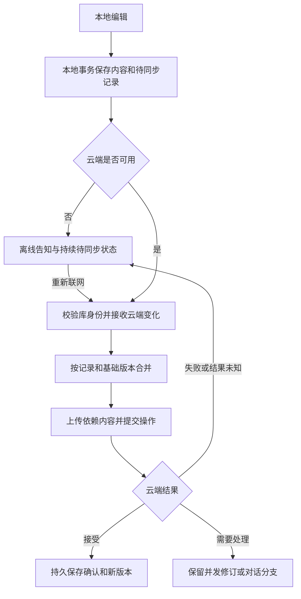

# 文献存储、离线同步与冲突处理设计

状态：**方案已确认；第一阶段已实现**

日期：2026-10-23

本文保留讨论中的设计依据。用户已确认按推荐方案实施；下文的建议表是已采用的默认规则，具体第一阶段边界见本节及 [Storage API v2](storage-api.md#record-synchronization-v2)。

### 第一阶段实现与边界

- 默认本地目录仍按原布局原地读取，不自动改写旧库。选择云端后，使用独立 SQLite 工作副本、事务待同步队列、内容寻址附件；云端 D1 保存逐条记录、删除标记、幂等操作与变更日志，R2 保存不可变字节及恢复快照。
- 自动同步在启动、保存、重连/窗口恢复时触发，后台每 30 秒重试。离线保存弹窗按每个页面的离线阶段提示一次，状态条持续显示待同步数量和冲突数量。保存到本地并不代表云端已确认。
- 首次建立元数据索引，以后按持久游标拉取变更；脏记录在上传前做三方合并，并用云端 CAS 提交。合并由通用客户端完成，后端无需了解笔记编辑器。收到确认期间继续编辑的内容仍保留为待同步。
- 批注独立字段合并；同一字段的不同修订完整保留并可选取或手动整理。处理旧冲突时若同一字段又有新编辑，新内容与所选结果保留为下一条冲突，不覆盖丢弃。等价高亮仅对锚点与样式完全一致的记录去重，保留 ID 别名。删除与编辑并发保留删除意图和内容，可显式恢复，不依赖两端提交顺序。
- 对话使用不可变父子消息，UI 显示分支选择器。并发追问保留兄弟分支，各自沿父链取上下文。原线性对话可重复地转换；同一已完成请求不会再次调用模型。离线问题保留为草稿，联网后须手动发送。
- 生成层级、翻译、处理缓存、未知扩展、分组、文献别名和 Zotero 绑定参与记录同步。不同记录可合并，同一生成结果或组织记录并发改变时保留冲突；第一阶段为这些非批注内容提供通用修订选择，尚无专门可视化差异编辑器。
- 设置统一为“文献存储”：本地目录或云端连接及缓存目录。保存后重启生效；现有库的上传是独立手动操作，支持重复导入，源目录不动，同 ID 不同原文跳过并报告。下载全部和清理已同步缓存相互独立。
- 待同步内容、未决请求及未处理冲突禁止切换目标/缓存目录；重启激活前再次检查原工作区，若保存设置后产生新修改则取消切换、保留原配置和凭据并显示原因。可导出含附件的恢复 ZIP。导出本身不会取消待同步状态或解除切换保护，须先同步并处理冲突。不同目标/账号工作区隔离，云端库身份变化拒绝写入。
- 云端和 HTTP 导入入口禁止原文替换；内部旧目录兼容工具 `local.replace_text` 暂保留供历史迁移和原有测试使用，不属于新同步协议。PDF 的同原件重新转换仍可更新派生表示。
- 升级后旧 v1 快照可读，首次 v2 提交后旧客户端写入返回 409，避免覆盖新消息树/修订。只新增数据库表，不删除旧快照或本地文件。
- 第一阶段不物理回收云端附件、删除标记、历史或变更日志。默认本地目录整体迁移到 SQLite、多账号权限管理、定时清理与专门的生成版本浏览器继续留待后续独立改动。

## 1. 目标与已确定的方向

1. 文献是最高层身份、索引和对外读写单位。调用方不处理后端文件路径、对象键或单个文件的读取细节。
2. 默认使用本地存储。开启云端后，**云端是唯一的 source of truth**，用于多设备访问同一份文献库。
3. 云端模式支持本地离线阅读与修改。本地尚未上传的修改属于待提交状态，不能被当作可丢弃缓存。
4. 离线保存必须明确告知用户“只保存到本机，尚未同步”；同时更新本地修改时间，联网后自动尝试同步。
5. 同步不能仅按设备时间戳决定覆盖。时间戳用于显示和辅助检查，基础版本与记录身份用于判断并发修改。
6. 原文不可修改。笔记、高亮、AI 对话及生成内容可以变化；不需要设计“原文被替换后的标注重新定位”同步流程。
7. 本地 SQLite、云端 D1 管理结构化记录；R2 保存原件、图片等二进制内容。SQL 负责事务、约束与记录粒度，合并规则由应用定义。
8. 大多数新增笔记、高亮自动合并；AI 对话的并发延续在 UI 中显示为 conversation fork。
9. 设置中的本地与云端配置合并到一个“文献存储”区域，并提供手动同步和已有本地文献上传入口。
10. 客户端云端入口保持通用，其他服务实现相同协议后也可接入。凭据使用 Python keyring，不进入文献库或同步数据。

### 本次不引入的能力

- 完整 Git 仓库、Git 远端和 Git 合并工作流。
- 通用 CRDT、逐字符协同编辑或实时多人协作。
- 依据时间戳直接选择整篇文献的胜出版本。
- 原文就地编辑、替换与由此产生的锚点迁移。
- 自动覆盖或删除已有本地文献库。

## 2. 术语与身份

| 术语 | 含义 |
| --- | --- |
| 文献 Document | 一份不可变原文及其批注、对话、生成内容的集合，具有稳定文献 ID |
| 原文 Source | 导入并确认的原始内容；一旦成为该文献的原文，内容不再修改 |
| 锚点 Anchor | 文献内的位置，包含段落/选区及原文引用上下文，用来定位批注 |
| 批注 Annotation | 一条高亮或笔记，具有独立、稳定的记录 ID，可引用共同锚点 |
| 对话 Conversation | 属于一篇文献、可附着于锚点的消息树 |
| 消息 Message | 对话中的一个节点，具有稳定 ID 与父消息 ID |
| 云端确认版本 | 已由云端接受并持久化的记录或文献版本 |
| 本地工作副本 | 云端确认内容叠加本机待提交修改后，当前设备展示的内容 |
| 已同步缓存 | 可以从云端重建、没有本机未上传修改的本地数据 |
| 待同步修改 | 已持久化到本机、尚未获得云端确认的修改 |
| 删除标记 Tombstone | 一次可同步的删除记录，用于防止离线设备把已删除内容重新带回来 |
| 同步游标 Cursor | 云端发出的不透明位置，表示本机已经持久接收了哪些云端变更 |

### 锚点与记录 ID 分开

同一处原文可以有一个高亮、多条笔记和多个对话；同一句文字也可能在不同段落重复。因此，选中文字不能单独充当笔记 ID。

建议采用以下规则：

- 文献 ID 是所有记录的所属范围，记录不能在同步时意外归入另一篇文献。
- 锚点定位依据不可变原文，优先使用稳定段落标识和明确选区，文字与上下文辅助校验。
- 批注和消息使用离线可生成的唯一 ID；本机创建后，跨设备同步不重新生成 ID。
- 只有确认位于同一文献、同一选区且内容等价的高亮才能自动去重；模糊文字匹配不能触发删除或覆盖。
- 去重必须保留旧 ID 到保留记录的映射，避免笔记、对话和已有链接失去引用。
- 标注生成摘要时，优先关联到原文锚点；无法映射的情况如何关联生成内容版本，列为待确认项。

## 3. 原文不可变

原文不可变是同步与定位的基础约束：

- 修改笔记、删除高亮、重新生成摘要或翻译，不修改原文。
- 清理本地缓存只移除可重新下载的副本，不修改或删除云端原文。
- 删除文献通过文献回收站/删除状态表达，不通过把原文内容改成空值表达。
- 原文和原始附件的已确认字节使用内容校验值验证；同一已确认内容引用不能被不同字节覆盖。
- 建议将内容不同的重新导入视为新文献；是否提供“相关文献/版本”关系另行决定。
- 缺失原件的补充下载、相同内容的缓存修复属于补全副本，不能成为替换已确认原文的入口。

首次导入过程中，解析、上传或校验尚未完成的内容可以处于草稿状态。原文发布完成后进入不可变状态，不能因另一设备上传或重新抓取而被覆盖。

## 4. 两种存储模式

| 项目 | 本地模式 | 云端模式 |
| --- | --- | --- |
| 权威文献库 | 当前设备的本地库 | 选定的云端库 |
| 本地数据用途 | 完整持久文献库 | 云端缓存、本地工作副本与待同步修改 |
| 离线阅读/修改 | 支持 | 支持，修改标记待同步 |
| 保存成功的含义 | 已持久化到本地库 | 先区分本机保存与云端确认，界面明确展示 |
| 多设备一致性 | 不自动共享 | 由云端接受变更并分发到设备 |
| 可清理内容 | 用户明确删除的数据 | 仅已同步且可重建的缓存 |

云端权威性不要求丢弃离线工作。本地修改在确认前保留其来源、基础版本与同步状态；其他设备只会看到云端已经接受的内容。

关闭云端后如何处理仍未同步的修改必须明确提示，不能通过切换模式隐式丢弃。切换服务、账号或文献库时，各库的缓存与待同步队列必须隔离，不能把旧库修改发送到新库。

## 5. 存储模块与对外接口

对外延续现有 `Document` / `DocumentInfo` / `StorageBackend` 的文献级接口方向。调用方按文献 ID 读取和保存，不需要知道 SQL 表、R2 对象键或同步队列。

建议在存储模块内部承担以下职责：

| 职责 | 对调用方的承诺 |
| --- | --- |
| 文献读取 | 返回一致的本地工作副本，包含已确认内容与本机待同步修改 |
| 文献保存 | 比较本地读取版本，在本地事务中保存变更及待同步记录 |
| 轻量索引 | 获取标题、语言、批注数与同步状态，不读取 PDF/图片 |
| 同步 | 推送待同步变更、接收云端变化、执行合并并返回状态 |
| 缓存管理 | 隐藏物理布局，保护待同步修改及其依赖内容 |
| 冲突保留 | 保存双方修订和关联信息，向 UI 提供可展示结果 |

“保存到本机”与“云端确认”需要分别可观察，具体通过返回值、事件或状态查询表达，待接口评审确定。

现有不透明 `revision` 不能同时混用成本地工作副本版本和云端基础版本。建议调用方继续持有不透明的本地读取版本，模块内部另存云端基础版本与操作身份。

文献级读取和保存不意味着每次同步都覆盖整篇文献。模块可以计算内部记录变化，按批注、消息等粒度提交；云端接受后再更新文献聚合版本和索引。跨记录不变量需要事务保护，应用不能把半份文献误当成发布完成的内容。

## 6. 数据模型建议

以下是概念结构，**不是已经确定的 SQL migration**。本地和云端共享领域身份与记录格式，本地另有缓存、同步队列和工作副本状态。

| 记录 | 主要信息与约束 |
| --- | --- |
| `documents` | 文献 ID、不可变原文身份/校验值、文献聚合版本、文献状态 |
| `assets` | 所属文献、逻辑资源 ID、内容校验值、大小与原件/生成附件类别 |
| `anchors` | 所属文献、稳定位置、原文选区及引用上下文 |
| `annotations` | 批注 ID、锚点、类型、正文/样式、记录版本、删除状态 |
| `annotation_revisions` | 笔记修订及基础版本；保留并发正文，不用时间戳抹掉一方 |
| `conversations` | 对话 ID、所属文献、可选锚点 |
| `messages` | 消息 ID、对话 ID、父消息 ID、角色、正文、生成状态与来源 |
| `generated_artifacts` | 摘要、翻译等派生版本及其模型/语言/原文关联 |
| `change_log` | 云端已接受变更、操作 ID、记录版本及同步游标所需信息 |
| `pending_changes` | 本机持久待提交变更及其基础版本、依赖、重试/确认状态；仅本地 |
| `sync_state` | 云端库身份、设备身份、已持久接收的游标；仅本地 |

SQL 记录必须覆盖不可丢失的领域数据。当前文献中的扩展数据、处理缓存与不认识的字段，在迁移时需要原样保留或明确映射，不能因为新表暂时未建模而丢弃。

PDF、图片等较大字节内容由 R2/本地文件保存；SQL 保存引用与校验信息。新内容先完成上传和校验，再发布引用它的云端记录。上传成功但记录提交失败可以留下待回收对象，不能提前删除仍可能被引用的内容。

### 时间与版本的职责

| 字段 | 用途 |
| --- | --- |
| `local_modified_at` | 每次本地编辑时更新，展示本机修改时间、辅助同步扫描 |
| `server_modified_at` | 展示云端接受时间，不证明本地编辑的因果先后 |
| `base_revision` | 标识这次修改基于哪个云端记录版本，用于三方比较 |
| `operation_id` | 标识一次逻辑操作，网络重试继续使用同一 ID |
| `record_revision` | 标识云端接受后的记录版本 |
| `cursor` | 拉取云端增量变化；不能由设备时间戳推算 |

不同设备时钟不一致、时间回拨或两个修改时间相同，都不能导致漏传、静默覆盖或重复记录。待同步队列是未确认修改的可靠来源，不能只扫描“时间戳比上次同步晚”的记录。

## 7. 保存与离线交互

### 本机保存

一次本地编辑需要在同一个 SQLite 事务中完成：保存工作副本、更新本地修改时间、记录操作身份/基础版本、写入待同步队列。事务完成后才能向用户报告“已保存到本机”。

不能出现“界面显示保存成功，但程序重启后没有这条修改或没有同步任务”的状态。本地磁盘写入失败时，报告保存失败并保留编辑器内容。

离线保存提示文案：

> 已保存到本机，尚未同步到云端。联网后将自动尝试同步。

弹窗触发频率、自动保存是否合并提示属于待确认交互细节。无论如何合并提示，不能省略离线保存告知和持续可见的待同步状态。

### 建议的状态展示

| 状态 | 含义 |
| --- | --- |
| 已同步 | 本机修改已获云端确认，且没有已知未处理变化 |
| 已保存到本机 · 待同步 | 本机持久保存成功，尚未得到云端确认 |
| 正在同步 | 正在传输或合并；本机仍可继续编辑 |
| 同步失败 · 本机内容已保留 | 连接、认证、容量等问题阻止同步 |
| 有待处理修订 | 部分变化需要用户确认，其余无冲突变化可以继续同步 |

一次请求发出、网络恢复或进度达到 100%，都不等于云端确认。界面应显示待同步文献/变更数量和最近一次成功同步时间。

## 8. 同步流程建议

自动触发至少包含重新联网；建议同时支持启动、窗口重新获得焦点及手动“立即同步”。具体后台间隔待确认。



推荐一次同步执行以下步骤：

1. 固定目标云端库与本地工作区，验证认证和协议能力；同步过程中切换设置不能改变这一批操作的目的地。
2. 获取云端增量变化；依据本机保留的基础版本合并，不能用拉取结果覆盖待同步修改。
3. 在本地事务中保存收到的变化及新游标；事务未完成时不能提前推进游标。
4. 按依赖关系提交待同步操作。记录新增所需的原件/附件应先上传校验；对话父节点应先于子节点存在。
5. 云端检查基础版本并应用合并规则，以事务保存记录变化、操作确认与变更日志。
6. 本机持久记录成功确认，只清除确实已确认的操作。同步期间新产生的修改仍留在队列中。
7. 必要时继续拉取其他设备刚提交的变化，直到完成本次批次或遇到需要重试的问题。

部分文献失败不能使已成功文献回滚，也不能把失败文献标为已同步。同步应给出完成、待处理和失败的具体结果。

### 重试与程序中断

- 请求超时可能发生在云端提交之后。重试同一 `operation_id`，云端返回既有结果，不能重复创建高亮、消息或分支。
- 同一操作 ID 携带不同内容应被拒绝并保留证据，不能把它当作普通重试。
- 重启后从持久队列继续，不能只依赖内存任务。
- 认证失败或云端不可用时继续保留本机修改，不切换到另一份文献库，也不清空队列。
- 本地还有待同步修改时，清缓存、退出账号或更换云端库必须保护这些数据。
- 删除日志或增量历史过期时，需要完整重新对账，并保留本机待同步修改；不能因“云端列表里不存在”就直接重建或删除文献。

## 9. 笔记与高亮的合并规则

以下为推荐规则；同一正文并发编辑的 UI、删除并发策略和样式胜出规则仍需确认。

| 场景 | 推荐处理 |
| --- | --- |
| 两台设备新增不同位置的高亮 | 合并新增记录 |
| 两台设备对同一明确选区新增等价高亮 | 自动去重，保留 ID 映射及相关引用 |
| 同一位置分别新增不同笔记 | 保留两条笔记，在同一锚点下展示 |
| 两台设备修改不同批注 | 各自应用，不产生整篇文献冲突 |
| 同一批注，一边改正文、一边改独立样式字段 | 基于共同版本按字段合并 |
| 同一字段被改成相同值 | 合并为同一结果 |
| 同一条笔记正文被改成不同内容 | 保留双方修订；不直接拼接正文，不按设备时间覆盖 |
| 同一高亮的颜色等低风险属性被改成不同值 | 保留修订，可采用确定性显示策略；具体规则待确认 |
| 重复收到同一删除操作 | 幂等处理 |
| 删除与另一设备新增评论/修改正文并发 | 保留删除意图与新增内容，进入可恢复的待处理状态 |
| 一台设备离线期间，整篇文献在云端被删除 | 保留本机修改和云端删除状态，不能自动复活文献；恢复/另存规则待确认 |

按字段合并要考虑字段关系，不能把 `anchor` 内的坐标、引用文字和上下文随意拼成不一致的锚点。`updated` 等派生时间字段不独立制造正文冲突。

删除需要可同步的标记，不能只执行一条物理 `DELETE`。删除标记和必要历史的保留期限、旧设备重新接入策略，必须与增量协议一起确定。

## 10. AI 对话：以分支表达并发

对话采用消息树。每条消息属于文献中的某个 conversation，并记录父消息 ID；共享历史只保存一份。

```text
问题 M1 → 回答 M2
             ├─ 手机上的追问 M3 → 回答 M4
             └─ 电脑上的追问 M5 → 回答 M6
```

推荐规则：

- 两台设备从同一条消息继续提问，合并后保留两个子分支；UI 提供分支入口与切换，不强行串成一条线性对话。
- 每个分支的上下文沿父节点向上取得，不能把兄弟分支的消息混入模型上下文。
- 编辑历史问题、修改已确认消息或重新生成回答，通过新节点/分支表达，不覆盖已确认的历史正文。
- 相同父节点和相同问题文字不自动去重；两次独立提问可能是用户有意重试。传输重复依据操作 ID 去重。
- 同一个生成请求的流式片段、最终完成和网络重试使用稳定消息/请求身份，不把每个片段变成新分支。
- 并发生成的不同回答保留为候选分支，不拼接成同一个回答。
- 删除对话与新增追问并发时，保护新增分支，具体隐藏/恢复交互待确认。

离线阅读已有对话与编辑本地笔记不等于支持离线调用云端模型。离线提问的草稿行为待确认；同步数据本身不能隐式重放付费模型调用。

## 11. 生成内容、文献组织与同步范围

除了批注，现有文献还包含生成层级、翻译、处理结果、原件附件和扩展内容；文献库还有分组、显示名称与 Zotero 绑定。

建议划分如下：

| 内容 | 建议同步方式 |
| --- | --- |
| 不可变原文及原始附件 | 按内容校验值上传、下载和复用，不做文本合并 |
| 笔记、高亮 | 记录级新增、修订、删除与去重 |
| AI 对话 | 消息树及分支 |
| 生成层级、翻译 | 保存可区分的生成版本；并发重新生成不覆盖原文或笔记 |
| 分组、文献显示名称 | 独立组织记录；并发移动/重命名策略待确认 |
| Zotero 绑定 | 与机器本地连接配置分开；绑定冲突策略待确认 |
| 处理缓存、未知扩展字段 | 迁移时保留，是否跨设备传输及保留多久待确认 |
| 模型密钥、云端密码、机器路径、设备界面偏好 | 不属于文献同步内容 |

第一阶段必须明确同步清单。即使某类内容暂不参与增量同步，迁移和整篇文献导出也不能静默丢失它。

## 12. 统一设置与手动操作

设置只提供一个“文献存储”区域，候选布局：

```text
文献存储
  存储方式：本地 / 云端

  本地模式：文献库目录
  云端模式：服务入口、用户名、密码、本地缓存目录

  当前状态：已同步 / 待同步 N 项 / 同步失败 / 有待处理修订
  操作：测试连接、保存设置、立即同步
  文献操作：导入已有本地文献到云端、下载供离线阅读、清理已同步缓存
```

具体按钮文案与布局待 UI review。需要满足的语义是：

- “立即同步”上传本机待提交修改并接收云端变化，不把整份本地目录覆盖到云端。
- “导入已有本地文献到云端”是显式导入操作，用于第一次启用和后续导入；源文献保留。
- “下载供离线阅读”补全缓存，不能覆盖尚未同步的本机修改。
- “清理缓存”不删除云端文献，也不删除待同步数据及其依赖附件。
- “删除文献”操作云端文献状态，应与清理缓存明显区分。
- 保存连接信息、选择云端模式和上传已有文献分别有明确效果，连接配置保存不能自动上传整个本地库。
- 模式切换、目录切换的生效时机及有待同步内容时的处理，需在 UI 中明确说明。

## 13. 兼容与迁移

### 当前实现与目标的差异

| 当前代码 | 本文目标 |
| --- | --- |
| 笔记保存在每篇文献的 JSON 数组中，更新整份 notes | 独立批注/消息记录，支持基础版本与修订 |
| 删除笔记直接从数组移除 | 删除标记参与同步 |
| AI 对话使用线性 `thread` 数组 | 消息树与 conversation fork |
| 本地目录后端保留旧文件布局 | 默认本地兼容保留，SQLite 迁移方案需 review |
| D1 管理文献快照指针，R2 保存完整快照及字节内容 | 结构化记录及变更同步，R2 管理不可变内容 |
| 云端客户端直接通过网络读写，无离线工作副本和持久队列 | 本地工作副本、持久待同步修改及自动重连同步 |
| 当前支持 `local.replace_text` 替换原文 | 原文不可变，该入口的关闭或兼容提示需单独处理 |
| 当前 wire protocol 是文献快照 CAS | 需要明确增量同步能力与协议版本，不能假定 v1 已支持 |

上表记录实施前的差异；已交付部分及兼容边界见本文开头的第一阶段说明。

### 建议迁移步骤

1. 在独立目标位置建立新数据结构，读取已有文献并保留现有 ID、原文、批注、对话、生成内容、扩展数据和文献组织信息。
2. 将旧线性对话映射成单分支消息树；迁移身份保持可重复，不因重试重复生成笔记或消息。
3. 校验记录数、关键关联及原件/附件校验值，确认新结构可以完整读取和导出后再切换。
4. 原文内容相同可复用上传字节；同一文献 ID 对应不同原文时停止该项导入并报告，不能替换目标原文。
5. 原文相同但两边批注不同，按记录合并；不能把“文献 ID 已存在”直接视为整篇内容无需导入。
6. 旧文献库保留为恢复来源。云端缓存使用明确独立的位置，不能把旧库直接改名为缓存并允许清理。
7. 云端现有快照按兼容路径升级，先验证恢复能力，再启用新同步协议；旧客户端不得静默丢失新修订或对话分支。

导入需要可中断、可重试并报告每篇文献结果；已经完成的导入不因后续失败而丢失，源库不因成功上传而被清空。

## 14. 验收场景

以下是验收标准；`tests/test_offline_storage.py`、`tests/test_ask_stop.py` 与 Worker 集成测试覆盖对应的持久化、合并与故障恢复场景。

| 场景 | 验收结果 |
| --- | --- |
| 离线新增笔记后立即重启 | 内容、修改时间与待同步记录均保留，用户已收到本机保存告知 |
| 断网保存后重新联网 | 自动尝试同步；获得确认后才变成已同步 |
| 两设备时间相差一天 | 不影响变更检测、去重或覆盖判断 |
| 两设备分别新增高亮/笔记 | 无需人工处理，所有新增内容可见 |
| 两设备重复标记同一明确选区 | 等价高亮去重，引用仍可用 |
| 两设备修改同一笔记的独立字段 | 合并两边字段，保留一致锚点 |
| 两设备修改同一笔记正文 | 两份修订均保留，不静默丢失内容 |
| 删除与编辑并发 | 删除意图和新内容均可恢复，无静默复活或丢失 |
| 同一回答上并发追问 | 显示两个分支，各分支上下文正确 |
| 上传已提交但确认响应丢失 | 重试不重复创建记录或分支 |
| 同步过程中继续编辑 | 后续修改仍在待同步队列中，不被本批次确认清掉 |
| 清理缓存时有未上传修改/附件 | 这些内容被保护，云端数据不受影响 |
| 本地磁盘写入失败或同步途中退出 | 不误报保存成功；可从持久状态恢复 |
| 切换云端库或账号 | 不向新目标发送旧库操作，不丢弃旧库待同步内容 |
| 导入旧库中断后重试 | 原库不变、不重复批注，原文和已有目标数据不被覆盖 |
| 导入同 ID 不同原文 | 报告身份冲突，保留双方原文 |

## 15. 已确认的推荐默认值

| 编号 | 待确认问题 | 当前建议 |
| --- | --- | --- |
| R1 | 同一笔记正文的并发修订如何展示和解决？ | 保留两个修订，允许选择或手动整理成新修订 |
| R2 | 删除与编辑并发，以及整篇文献删除后收到离线修改，默认显示什么？ | 保留删除意图与新内容，提供恢复/另存入口 |
| R3 | 颜色等低风险字段并发修改采用什么显示策略？ | 确定性默认值，保留历史，不按设备时间静默丢弃 |
| R4 | 等价高亮去重是否跨语言、跨展示层级？ | 第一阶段仅对可以明确映射到同一原文选区的记录去重 |
| R5 | 第一阶段是否包含分组、显示名称、Zotero 绑定与处理缓存的增量同步？ | 核心原文/批注/对话优先，逐项确定范围；迁移仍完整保留 |
| R6 | 离线保存弹窗频率、自动保存提示以及离线提问草稿如何处理？ | 明确告知本机保存，保留持续状态；不自动重放模型调用 |
| R7 | 未同步内容存在时，如何切库、退出账号或关闭云端？ | 保留隔离工作区，先提供同步/导出/取消操作 |
| R8 | 删除标记、历史与旧设备同步游标保留多久？ | 制定保留与完整重同步规则后，再实现物理回收 |
| R9 | 何时启用 SQLite，如何保留旧目录后端与兼容旧客户端？ | 分阶段迁移并验证，目标协议明确版本/能力检查 |
| R10 | 不同原文重新导入、并发生成摘要/翻译如何呈现？ | 新原文创建新文献；生成结果保存独立版本，UI 后续确认 |

## 16. 现有实现参考

- [文献级存储接口](storage.md)、[当前云端快照协议](storage-api.md)。
- [当前笔记数据格式](notes-format.md)。
- [`Document` 与后端协议](../textfold/documents.py)。
- [当前笔记新增、编辑、删除与对话逻辑](../textfold/notes.py)。
- [当前本地原文替换入口](../textfold/local.py)。
- [当前 D1 快照索引结构](../cloudflare/storage/migrations/0001_storage.sql)。

这些文件及本文开头的实现说明描述当前行为；历史设计讨论中的“待确认”项目以第一阶段说明的已选规则为准。
